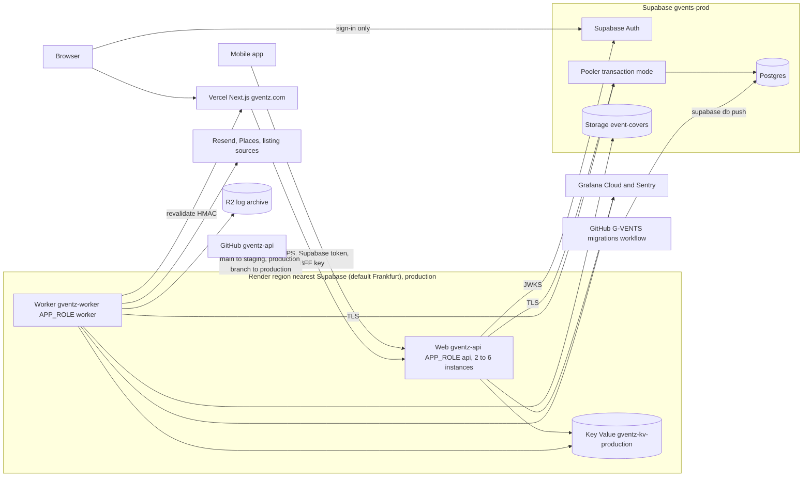

# U1 Platform — Deployment Architecture (version 2, Change 1)

Version 1 is in `v1/deployment-architecture.md`.

## Diagram



Text alternative:
- **Browser:** signs in with Supabase Auth and otherwise talks to the Next.js app on Vercel. Next.js calls the production API over HTTPS with the user's Supabase token and the BFF key.
- **Mobile app:** calls the API directly.
- **Render production environment** (default Frankfurt, matched to Supabase's region): the API runs 2 to 6 web instances and a separate worker. Both use Render Key Value, and reach Supabase Postgres through the pooler over TLS.
- **API:** fetches Supabase's signing keys.
- **Worker:** uses Supabase Storage, calls Next.js to revalidate pages, sends email through Resend, calls the outside sources, and archives logs to R2.
- **Monitoring:** both API and worker send logs, metrics and traces to Grafana Cloud and errors to Sentry.
- **Deploys:** GitHub deploys the API's `main` branch to staging and its `production` branch to production. The G-VENTS migrations workflow applies schema changes to Supabase.

Staging has the same shape, with one Render web service (`APP_ROLE=all`), Key Value Starter and the `gvents-staging` project.

## `render.yaml` Blueprint (outline; exact plan ids checked against Render's spec in CG)

```yaml
projects:
  - name: G-ventZ
    environments:
      - name: staging
        networking: { isolation: enabled }
        services:
          - type: web
            name: gventz-api-staging
            runtime: docker
            region: frankfurt          # O9: change to the Render region nearest Supabase
            plan: starter
            branch: main
            autoDeployTrigger: checksPass
            healthCheckPath: /health/ready
            maxShutdownDelaySeconds: 30
            envVars: [APP_ROLE=all, APP_ENV=staging, DATABASE_URL (sync false), REDIS_URL (fromService), SUPABASE_*, OTEL_*, LOKI_*, SENTRY_*, ...]
          - type: keyvalue
            name: gventz-kv-staging
            plan: starter
            maxmemoryPolicy: noeviction
            persistenceMode: journal-snapshot
            ipAllowList: []
      - name: production
        networking: { isolation: enabled }
        permissions: { protection: enabled }
        envVarGroups: [gventz-production]
        services:
          - type: web
            name: gventz-api
            runtime: docker
            region: frankfurt
            plan: standard
            branch: production
            autoDeployTrigger: checksPass
            healthCheckPath: /health/ready
            maxShutdownDelaySeconds: 30
            scaling: { minInstances: 2, maxInstances: 6, targetCPUPercent: 70, targetMemoryPercent: 80 }
          - type: worker
            name: gventz-worker
            runtime: docker
            region: frankfurt
            plan: standard
            branch: production
            autoDeployTrigger: checksPass
          - type: keyvalue
            name: gventz-kv-production
            plan: standard
            maxmemoryPolicy: noeviction
            persistenceMode: journal-snapshot
            ipAllowList: []
```

No `databases:` block is needed, because Supabase holds the data.

## Docker Image

```text
Stage 1 (build): node:22-slim@sha256:<pinned>, npm ci, npm run build, npm prune --omit=dev
Stage 2 (run):   node:22-slim@sha256:<pinned>, non-root user, copy dist + node_modules + certs/
                 CMD ["node", "--import", "./dist/telemetry/register.js", "dist/main.js"]   # OTel starts first
```

## Deploy Pipeline

```text
G-VENTS PR (migrations) -> local supabase reset + pgTAP
merge (feature/backend-split|main) -> supabase db push (staging)
gventz-api PR -> CI (lint, types, unit+PBT, integration on supabase/postgres + migrations, build, OpenAPI + schema drift, audit)
merge main -> Render staging: build -> start -> /health/ready -> switch (rolling)
release: run production migrations (manual dispatch, approver) -> tag v1.x.y -> production branch
production branch -> Render prod web (rolling, 2-6) + worker
rollback -> Render "Rollback" (schema additive, no database rollback)
```
