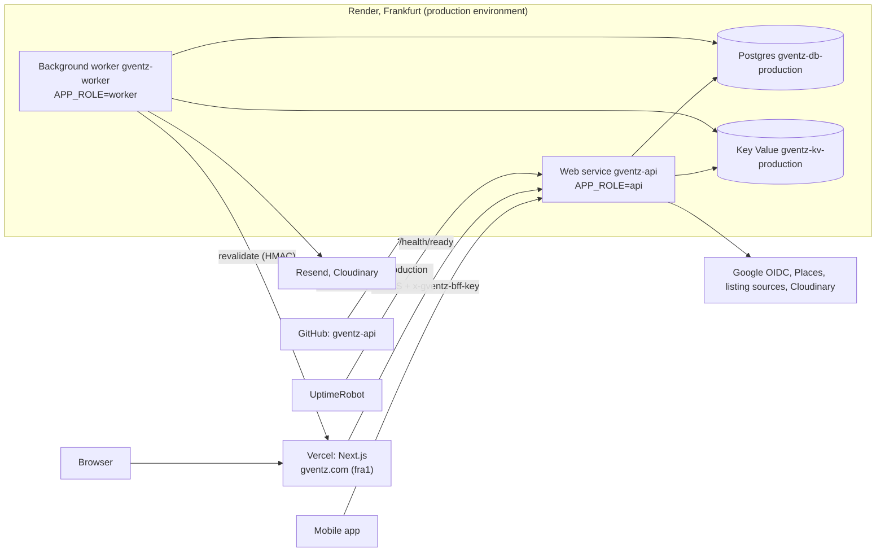

# U1 Platform Foundation — Deployment Architecture

## Diagram



Text alternative:
- Browsers reach the Next.js app on Vercel. It calls the production API on Render over HTTPS with the BFF secret header.
- The mobile app calls the API directly.
- In Render's Frankfurt production environment, the API web service and the background worker both use the production Postgres and Key Value over the private network.
- The worker sends email through Resend, manages files in Cloudinary, and calls Next.js to revalidate pages.
- The API calls Google sign-in, Google Places, the listing sources and Cloudinary.
- UptimeRobot checks the readiness endpoint.
- GitHub deploys `main` to staging and the `production` branch to production.

Staging has the same shape with one web service (`APP_ROLE=all`) and no separate worker.

## `render.yaml` blueprint (outline)

> **Updated in Code Generation (2026-10-23):** the real file is `gventz-api/render.yaml`. Checked against Render's Blueprint spec, it uses plan ids `0.5c-512mb` (web and worker), Key Value `free` (staging) and `256mb` with `persistenceMode: journal-snapshot` (production), Postgres `0.1c-256mb` (staging) and `0.5c-1g` (production), and **PostgreSQL 18**, which is the newest Render offers (Q5 A). The staging and production environments are declared in a `projects` block. The outline below is kept as designed.

Field names follow Render's Blueprint specification. They are checked against Render's current docs when the file is written in Code Generation.

```yaml
envVarGroups:
  - name: gventz-staging
    envVars: [ ... non-secret values; secrets marked sync: false ... ]
  - name: gventz-production
    envVars: [ ... ]

services:
  - type: web
    name: gventz-api-staging
    runtime: docker
    region: frankfurt
    plan: starter
    branch: main
    healthCheckPath: /health/ready
    preDeployCommand: npm run db:migrate
    autoDeployTrigger: checksPass
    envVars:
      - key: APP_ROLE
        value: all
      - key: APP_ENV
        value: staging
      - fromGroup: gventz-staging
      - key: REDIS_URL
        fromService: { type: keyvalue, name: gventz-kv-staging, property: connectionString }
      - key: MIGRATION_DATABASE_URL
        fromDatabase: { name: gventz-db-staging, property: connectionString }

  - type: keyvalue
    name: gventz-kv-staging
    region: frankfurt
    plan: free
    maxmemoryPolicy: noeviction
    ipAllowList: []          # private network only

  - type: web
    name: gventz-api
    runtime: docker
    region: frankfurt
    plan: starter
    branch: production
    healthCheckPath: /health/ready
    preDeployCommand: npm run db:migrate
    autoDeployTrigger: checksPass
    envVars: [ APP_ROLE=api, APP_ENV=production, fromGroup gventz-production, REDIS_URL, MIGRATION_DATABASE_URL ]

  - type: worker
    name: gventz-worker
    runtime: docker
    region: frankfurt
    plan: starter
    branch: production
    autoDeployTrigger: checksPass
    envVars: [ APP_ROLE=worker, APP_ENV=production, fromGroup gventz-production, REDIS_URL ]

  - type: keyvalue
    name: gventz-kv-production
    region: frankfurt
    plan: starter            # smallest paid, persistent
    maxmemoryPolicy: noeviction
    ipAllowList: []

databases:
  - name: gventz-db-staging
    region: frankfurt
    plan: basic-256mb        # smallest paid at creation time
    postgresMajorVersion: "17"   # newest offered at creation
    ipAllowList: []
  - name: gventz-db-production
    region: frankfurt
    plan: basic-1gb          # Basic tier with backups
    postgresMajorVersion: "17"
    ipAllowList: []
```

Staging and production resources are assigned to the "staging" and "production" environments of the "G-ventZ" project, in the dashboard or through the blueprint's project block if your Render plan supports it. Plan names and the Postgres version are confirmed at creation against Render's current list.

## Docker image

```text
Stage 1 (build):  node:22-slim, npm ci, npm run build (SWC), npm prune --omit=dev
Stage 2 (run):    node:22-slim, non-root user, copy dist + node_modules + drizzle/
                  CMD ["node", "dist/main.js"]   (APP_ROLE decides api/worker/all)
```

- `npm run db:migrate` runs `drizzle-kit migrate`, or the Drizzle migrator script, against `MIGRATION_DATABASE_URL`, with `lock_timeout = 5s`.
- The image has no secrets. Everything comes from the environment.

## Deploy pipeline

```text
PR ──> CI (lint, typecheck, unit+PBT, integration, build, OpenAPI drift)
merge main ──> Render staging: build image -> pre-deploy migrate -> start -> /health/ready -> switch traffic
git tag v1.0.0 && push ──> release.yml fast-forwards branch production
production branch ──> Render prod web: build -> migrate -> start -> ready -> switch
                   └─> Render prod worker: build -> start (no migrate)
rollback ──> Render "Rollback" to previous deploy (schema stays compatible: expand/contract)
```

## First-time setup checklist (you)

| # | Step | Needed for |
|---|---|---|
| 1 | Create the GitHub repository `gventz-api` and give me the remote URL. Until then the local repo at `/Users/payazaafrica/gventz-api` is used. | Render deploys (O2) |
| 2 | In Render: create the project "G-ventZ" with environments "staging" and "production"; connect GitHub; apply `render.yaml` (Blueprint) | All |
| 3 | Run `scripts/db/bootstrap-roles.sql` once per database (I'll give the exact command) and store the `gventz_app` connection string as `DATABASE_URL` in each environment group | U1-SEC7 |
| 4 | Generate and set the secrets: `BFF_SHARED_SECRET`, `JWT_ACCESS_SECRET`, `REVALIDATE_SECRET` (I'll give a command that prints random values) | U1, U2, U5 |
| 5 | Turn on Render email notifications for both environments | Q4 A |
| 6 | Confirm the DNS provider; add the `api` and `api-staging` CNAMEs; add the custom domains in Render | O3 |
| 7 | Create an UptimeRobot monitor on `/health/ready` (production) | Q4 B |
| 8 | Give me the Supabase **staging** direct connection string (read access) for the M1 copy | Q2 A |
| 9 | Google OAuth client (O4), Resend domain (O5), Cloudinary (O6) | U2, U5 |

Steps 1, 2, 3, 4 and 8 are needed for M1 on Render. Everything can also run locally with `docker compose` while they are pending.
