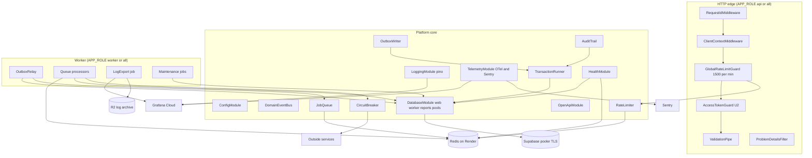

# U1 Platform — Logical Components (version 2, Change 1)

Version 1 is in `v1/logical-components.md`.

## Component Diagram

Text alternative:
- **Request path:** a request passes through the request id, client context, the general rate limit (1,500 a minute per IP, backed by Redis), the token guard and validation. Errors at any point go to the problem-details filter.
- **Saving changes:** `TransactionRunner` uses the database pools, which reach Supabase through the pooler over TLS. `OutboxWriter` and `AuditTrail` write inside the same transaction.
- **Worker:**
  - The outbox relay reads the outbox table and puts jobs on Redis.
  - Queue processors take jobs and call outside services through circuit breakers.
  - The log export job reads Grafana Loki and writes to R2.
  - Maintenance jobs clean up the database.
- **Health checks** cover both the database and Redis.
- **Telemetry:** logs and traces go to Grafana Cloud, and errors go to Sentry.

## Components (new or changed; others as in version 1)

| Component | Responsibility | Interface | Settings | On failure |
|---|---|---|---|---|
| `DatabaseModule` (changed) | Three `pg` pools (`web`, `worker`, `reports`) to the Supabase pooler with TLS verification; Drizzle instances; generated schema | `DRIZZLE` (web or worker by role), `DRIZZLE_REPORTS` | `DATABASE_URL`, `DATABASE_CA_FILE`, pool maximums | Acquire timeout → 503; readiness down |
| `OutboxWriter` (new) | Insert outbox rows inside the current transaction | `OutboxWriter.append(events)` | — | Error rolls back the business change |
| `OutboxRelay` (new, worker) | Claim undispatched rows (SKIP LOCKED, batches of 200, every 1 s), enqueue with stored job id, mark dispatched | Repeatable job `outbox-relay` | batch size, interval | Redis down → rows wait; relay errors logged; `outbox_backlog` metric alerts above 1,000 |
| `CircuitBreaker` (new) | Timeout plus breaker per named dependency (`opossum`) | `run(name, call, { timeoutMs })` | thresholds per dependency | Open → `ServiceUnavailable` at once |
| `TelemetryModule` (new) | OpenTelemetry SDK (traces, metrics) started before Nest boots; Sentry init; `Metrics` interface for business counters | `Metrics`, automatic instrumentation | `OTEL_*`, `SENTRY_*` | Exporter failures never affect requests (dropped with a debug log) |
| `LoggingModule` (changed) | pino JSON to stdout plus a `pino-loki` transport; redaction; trace and request ids in every line | `PinoLogger` | `LOKI_*`, `LOG_LEVEL` | Loki unreachable → stdout still written; transport buffers, then drops |
| `LogExportJob` (new, worker) | Nightly export of the previous day from the Loki API to R2 (hourly gzip NDJSON); records counts | Repeatable job `log-export` 03:00 UTC | `LOG_ARCHIVE_*`, `LOKI_*` | Retries 5 times; final failure alerts (`log_export_failed`) |
| `MaintenanceJobs` (changed) | Delete dispatched outbox rows after 7 days; stale cache keys | `maintenance` queue | — | Retry; log |
| `GlobalRateLimitGuard` (changed) | 1,500 a minute per client IP; excludes health and webhooks | Guard | `RATE_LIMIT_GLOBAL_PER_MINUTE` | Redis down → allow, warn |
| `RateLimiter` (changed) | Fixed window; per-policy `onStoreFailure` (closed for `orders.place`, `checkout.start`, `checkin.scan`) | `consume(policy, subject)` | Policies per module | As per policy |
| `HealthModule` | `/health/live`, `/health/ready` (database `select 1` via the web pool, Redis `PING`) | HTTP | — | 503 with the failing check |

## Request-Scoped Context (CLS)

| Key | Set by | Used by |
|---|---|---|
| `requestId`, `traceId` | RequestIdMiddleware, OpenTelemetry | Logs, problem bodies, outbox payloads, job data |
| `client` | ClientContextMiddleware | Rate limits, audit, logs |
| `user` (`id`, `email`, `aal`) | AccessTokenGuard (U2) | Services, guards, logs (user id only), audit |
| `tx` | TransactionRunner | Repositories, OutboxWriter, AuditTrail |
| `events` | Aggregates on save | OutboxWriter, DomainEventBus |

## Process Layout per Environment

| Environment | Processes | APP_ROLE | Database | Redis | Telemetry |
|---|---|---|---|---|---|
| Local | `npm run start:dev` + `docker compose` (supabase/postgres image with migrations, Redis) | `all` | Local container | Local container | stdout only (OTel off by default) |
| CI | Vitest + Testcontainers | n/a | `supabase/postgres` container with `G-VENTS/supabase/migrations` | Container | Off |
| Staging | 1 Render web service (Starter); deploys from the backend `main` branch | `all` | `gvents-staging` pooler | Key Value Starter | Grafana and Sentry (environment `staging`) |
| Production | Render web service (Standard, 2 to 6, autoscaling) + background worker (Standard ×1); deploys on `v*` tag | `api` / `worker` | `gvents-prod` pooler | Key Value Standard, persistent | Grafana and Sentry (environment `production`) |

## Compliance Check (this stage)

**Security:**

| Rule | Status | Notes |
|---|---|---|
| SECURITY-01 | Compliant | TLS verify-full to Supabase; Redis on the private network; TLS confirmed in Infra |
| SECURITY-03 | Compliant | Structured logs, redaction, central Loki |
| SECURITY-05 | Compliant | Validation pipe and size limits |
| SECURITY-06 | Compliant | `gventz_api` grants are table-specific; audit and ledger are insert-only |
| SECURITY-09 | Compliant | Generic errors; Swagger off in production |
| SECURITY-10 | Compliant | Lock file, audit, SBOM, pinned images |
| SECURITY-11 | Compliant | Rate limits; isolation |
| SECURITY-13 | Compliant | Append-only audit |
| SECURITY-14 | Compliant | Alerts; 14-day search plus a 90-day-or-longer archive the app can't delete |
| SECURITY-15 | Compliant | Global filter; fail closed; cleanup on shutdown |
| SECURITY-02, 04, 07 | Completed in Infra and U6 | — |
| SECURITY-08, 12 | Completed in U2 | — |

**Resiliency:**

| Rule | Status | Notes |
|---|---|---|
| RESILIENCY-05 | Compliant | Metrics, logs, traces and dashboards defined |
| RESILIENCY-06 | Compliant | Health endpoints plus Render routing plus synthetics |
| RESILIENCY-07 | Compliant | Capacity, backlog and breaker metrics with alerts |
| RESILIENCY-09 | Compliant | Autoscaling 2–6, pre-scale, connection budget |
| RESILIENCY-10 | Compliant | Timeouts, breakers, bulkhead pools, degraded modes |
| RESILIENCY-12 | Compliant (with gate O19) | Daily backups; point-in-time recovery before go-live |
| RESILIENCY-14 | Compliant | Test plan RT1–RT5 |
| RESILIENCY-03, 04, 08, 11, 13, 15 | Recorded | In requirements and the Infra Design and runbooks |

**PBT:** properties carried over from U1 version 1 (business-logic-model §7). New ones for U1 CG:
- **Outbox relay:** every committed row is dispatched exactly once by job id, under random interleavings of relay runs.
- **Breaker state machine:** a stateful property.
