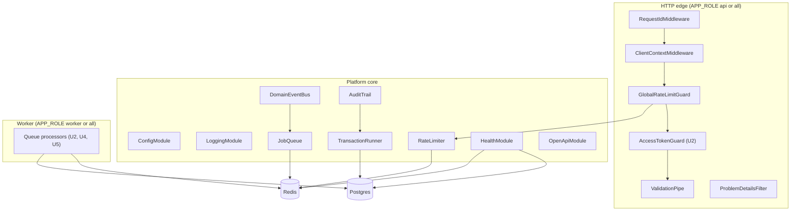

# U1 Platform Foundation — Logical Components

## Component diagram

Text alternative: an incoming request passes through RequestIdMiddleware, ClientContextMiddleware, the global rate-limit guard (which uses the RateLimiter on Redis), the access-token guard and the validation pipe. Errors at any point go to ProblemDetailsFilter. Inside, TransactionRunner talks to Postgres, and AuditTrail writes within its transaction. DomainEventBus dispatches after commit to JobQueue on Redis. Worker processors read jobs from Redis and may use Postgres. Health checks both Postgres and Redis.

## Components

| Component | Responsibility | Interface | Config | On failure |
|---|---|---|---|---|
| `ConfigModule` | Load and validate settings per role; typed config classes (`DatabaseConfig`, `RedisConfig`, `HttpConfig`, `AuthConfig`, ...) | Injected config classes | env | Exit with the names of missing settings |
| `LoggingModule` | pino JSON logs, request context, redaction | `PinoLogger`, Nest `Logger` | `LOG_LEVEL` | Never throws |
| `RequestIdMiddleware` | Keep or create `x-request-id`; put it in CLS and the response | — | — | — |
| `ClientContextMiddleware` | Resolve `clientIp` and `via` (web or direct) | `ClientContext` in CLS | `BFF_SHARED_SECRET` | Bad key → treat as direct, log `warn` |
| `GlobalRateLimitGuard` | 300/min per `clientIp` | Guard | `RATE_LIMIT_GLOBAL_PER_MINUTE` | Redis down → allow, `warn` |
| `RateLimiter` | Fixed-window counters; `consume(policy, subject)` | `RateLimiter` interface | Policies per module | Per policy `onStoreFailure` |
| `ValidationPipe` | DTO validation to `ValidationFailed` | Global pipe | — | 400 problem |
| `ProblemDetailsFilter` | Map errors to RFC 9457 | Global filter | — | Unknown → 500 `internal_error` |
| `DatabaseModule` | `pg` Pool + Drizzle instance + schema | `DRIZZLE` token | `DATABASE_URL`, `DATABASE_POOL_MAX` | Connect errors → readiness down |
| `TransactionRunner` | `@Transactional()` via CLS; retry on 40001 and 40P01; nested calls join | Decorator + `TransactionHost` | — | Rollback; rethrow after 3 attempts |
| `DomainEventBus` | Collect events per transaction; dispatch after commit in order | `DomainEventPublisher`, `@OnDomainEvent()` handlers | — | Handler error → log, continue |
| `AuditTrail` | Insert `audit_log` rows inside the current transaction | `AuditTrail.record(entry)` | — | Error rolls back the action (same transaction) |
| `RedisModule` | Shared `ioredis` clients (commands; separate connection for BullMQ) | `REDIS` token | `REDIS_URL` | Auto-reconnect; readiness down |
| `JobQueue` | Typed enqueue with standard options per queue (`email`, `revalidation`, `media-cleanup`) | `JobQueue<T>.add()` | `QUEUE_*` | Log `job.enqueue_failed` (Q3 A) |
| Queue processors | Registered only when role includes worker; owned by U2, U4, U5 | `@Processor()` classes | concurrency | Retry, then final-failure log |
| `HealthModule` | `/health/live`, `/health/ready` | HTTP | — | 503 with failing check |
| `OpenApiModule` | Build OpenAPI from controllers and DTOs; `/openapi.json`, `/docs` outside production | HTTP | `NODE_ENV` | — |
| `Clock`, `IdGenerator` | Time and UUID v7 | Injected interfaces | — | — |
| `DbErrorTranslator` | Map Postgres errors (23505, 23514, 23503) to domain errors for repositories | Helper used by repositories | — | Unknown → rethrow (500) |

## Request-scoped context (CLS)

| Key | Set by | Used by |
|---|---|---|
| `requestId` | RequestIdMiddleware | Logs, problem bodies, job payloads (for tracing) |
| `client` (`clientIp`, `via`, `userAgent`) | ClientContextMiddleware | Rate limits, audit meta (`client`), logs |
| `user` (`userId`, `sessionId`) | AccessTokenGuard (U2) | Services, logs, audit |
| `tx` | TransactionRunner | Repositories, AuditTrail |
| `events` | Repositories | DomainEventBus |

## Process layout per environment

| Environment | Processes | APP_ROLE | Redis |
|---|---|---|---|
| Local | `npm run start:dev` + `docker compose` | `all` | Local container |
| CI | Test process with Testcontainers | n/a | Container |
| Staging | One Render web service | `all` | Render Key Value free tier |
| Production | Render web service + Render background worker | `api` / `worker` | Render Key Value paid, persistent |
