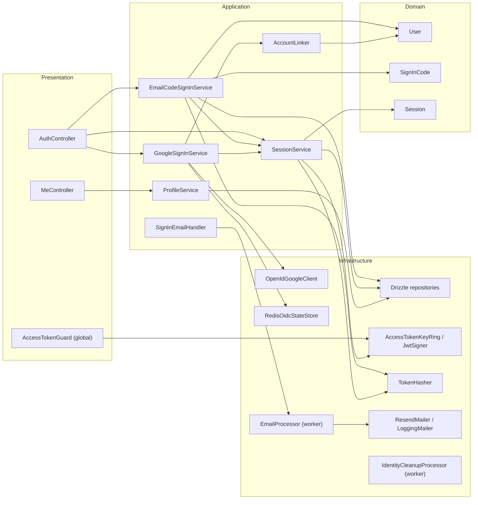

# U2 Identity — Logical Components

## Diagram

Text alternative:
- **Presentation:** `AuthController` calls the email-code, Google and session services. `MeController` calls the profile service. The global `AccessTokenGuard` uses the key ring.
- **Application:** the email-code service works with the `SignInCode` and `User` domain objects. The Google service uses the OIDC client, the Redis state store and the account linker. The session service works with `Session` and the key ring.
- **Infrastructure:** services persist through Drizzle repositories and hash through `TokenHasher`. The sign-in email handler enqueues work for the `EmailProcessor` (worker only), which sends through the mailer.

## Components

| Component | Layer | Interface (port) | Implementation | Config | On failure |
|---|---|---|---|---|---|
| `AuthController` | presentation | REST `/v1/auth/*` | Nest controller, `@Public()` except sign-out routes | — | Problem details |
| `MeController` | presentation | REST `/v1/me` | Nest controller | — | — |
| `AccessTokenGuard` | presentation | global `APP_GUARD` | Uses `AccessTokenVerifier`, sets the principal | — | 401 `auth.token_*` |
| `CurrentUser` | presentation | param decorator | Reads the principal from `RequestContext` | — | Throws if no principal |
| `EmailCodeSignInService` | application | `requestCode`, `verifyCode` | `@Transactional()` | rate policies | Domain errors |
| `GoogleSignInService` | application | `start`, `complete` | — | allowlist | 400/401/422/503 |
| `SessionService` | application | `start`, `refresh`, `signOut`, `signOutAll` | — | lifetimes | 401 `auth.*` |
| `ProfileService` | application | `getMe`, `update` | — | — | — |
| `AccountLinker` | application | `resolve(claims, now)` | Decision table GS6 | — | — |
| `SignInEmailHandler` | application | `@OnDomainEvent('identity.sign_in_code_issued')` | Enqueue a secret job | — | Logged by `JobQueue` |
| `UserDirectory` (exported) | application | `getContact(userId)` | Read query | — | `user.not_found` |
| `UserRepository`, `SignInCodeRepository`, `SessionRepository` | domain ports | load and save aggregates | Drizzle, `uow.collectFrom` | — | `translateDbError` |
| `AccessTokenSigner` / `AccessTokenVerifier` | domain ports | `sign(claims)`, `verify(token)` | `JoseAccessTokens` + `AccessTokenKeyRing` | `JWT_*` | `auth.token_invalid` / `_expired` |
| `TokenHasher` | domain port | `hashCode(email, code)`, `hashRefresh(token)`, `equal(a, b)` | Node crypto | `SIGN_IN_CODE_SECRET` | — |
| `GoogleOidcClient` | application port | `authorizationUrl(...)`, `exchange(...)` → claims | `OpenIdGoogleClient` (`openid-client`) | `GOOGLE_*` | `ServiceUnavailable` / `auth.google_token_invalid` |
| `OidcStateStore` | application port | `put`, `take` | `RedisOidcStateStore` | — | `ServiceUnavailable` |
| `Mailer` (exported) | application port | `send(message, idempotencyKey)` | `ResendMailer` (fetch); `LoggingMailer` (development) | `RESEND_*`, `EMAIL_FROM` | `PermanentEmailError` / transient throw |
| `EmailComposer` (exported) | application | `signInCode(...)` (U4 adds `ticket(...)`) | Template classes, `escapeHtml` | — | — |
| `EmailProcessor` | infrastructure | BullMQ `@Processor('email')` | Worker role only | concurrency | Retry, or `UnrecoverableError` |
| `IdentityCleanupProcessor` | infrastructure | `@Processor('maintenance')` | Daily repeatable job | — | Logged; retried next day |

## Module public interface (`src/modules/identity/index.ts`)
`IdentityModule`, `UserDirectory`, `AuthenticatedUser`, `CurrentUser`, `Mailer`, `EmailMessage`, `EmailComposer`. The `AccessTokenGuard` is registered globally by `IdentityModule`, so other modules don't import it.

## Endpoints delivered by U2
`POST /v1/auth/email/code` · `POST /v1/auth/email/verify` · `POST /v1/auth/google/start` · `POST /v1/auth/google/callback` · `POST /v1/auth/refresh` · `POST /v1/auth/sign-out` · `POST /v1/auth/sign-out-all` · `GET /v1/me` · `PATCH /v1/me`
