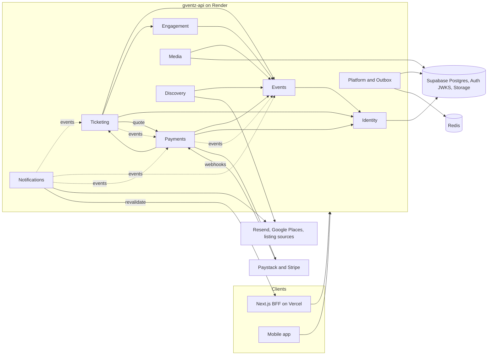

# Component Dependencies (version 2, Change 1)

Version 1 is in `v1/component-dependency.md`.

## Dependency Matrix

Rows depend on columns. Every module depends on Platform and Shared.
- **P:** through the column module's public interface (`index.ts`).
- **E:** subscribes to the column module's domain events, through the outbox.
- **I:** implements a port that the column module declares.

| Depends on → | Identity | Events | Engagement | Ticketing | Payments | Media | Discovery | Notifications |
|---|---|---|---|---|---|---|---|---|
| **Identity** | — | | | | | | | |
| **Events** | P | — | | P (`TicketingStats`) | | | | |
| **Engagement** | P | P (guard) | — | | | | | |
| **Ticketing** | P (`UserDirectory`) | P (guard, `EventPurchaseRules`) | P (`QuestionCatalog`) | — | P (`FeeQuotePort`, M4), E (`PaymentSucceeded`, `RefundSucceeded`) | | | |
| **Payments** | P (`RequireMfa`, staff guard, `UserDirectory`) | P (`EventPurchaseRules`), I (`PayoutReadiness`), E (`EventCancelled`) | | P (`OrderReader`), E (`LatePaymentUnfillable`) | — | | | |
| **Media** | P | P (`EventCoverPort`), E | | | | — | | |
| **Discovery** | P | P (`EventQueryService`) | | | | | — | |
| **Notifications** | P, E | P, E | E | P (`OrderReader`), E | E | E | | — |

**No cycles at compile time:**
- Events declares `PayoutReadiness` and `TicketingStats`. Payments and Ticketing implement them, wired by injection tokens.
- Ticketing declares `FeeQuotePort`, which Payments implements.
- Payments and Ticketing otherwise talk only through outbox events.
- Identity depends on nothing.
- Nothing depends on Notifications.

## Communication Patterns

| Pattern | Used for | Mechanism |
|---|---|---|
| Synchronous call through a public interface | Reads and checks needed to finish a request (permissions, purchase rules, questions, quotes, payout readiness) | NestJS DI, exported providers or tokens |
| **Outbox event** | Durable cross-module work and side effects (emails, revalidation, apply payment, refunds, voiding tickets) | `outbox_events` written in the same transaction → relay → BullMQ, with idempotent handlers |
| In-process event after commit | Metrics and other non-essential reactions | `DomainEventBus` |
| Durable job | Email, revalidation, cleanup, hold expiry, webhook inbox, refunds, reconciliation | BullMQ with deterministic job ids, backoff with jitter |
| Inbound webhook | Paystack and Stripe events | Signature check → `webhook_inbox` → 200 → worker |
| HTTP to the outside | Supabase JWKS and Storage, Resend, Google Places, listing sources, Paystack, Stripe, Next.js revalidation | Adapters behind interfaces; timeouts and circuit breakers |

## Module Dependency Diagram



Text alternative:
- **Callers:** the Next.js BFF and the mobile app call the API. Paystack and Stripe send webhooks to Payments.
- **Ticketing** uses Events, Engagement and Identity, and asks Payments for fee quotes.
- **Payments** uses Events, Ticketing and Identity.
- **Event flows:** Ticketing reacts to Payments events (payment succeeded, refund succeeded). Payments reacts to Events' cancellation. Notifications reacts to events from Ticketing, Events and Payments.
- **Media and Discovery** use Events.
- **Supabase:** Platform reaches Supabase Postgres and Redis. Identity fetches Supabase's signing keys. Media uses Supabase Storage.
- **Other outside services:** Payments calls Paystack and Stripe. Discovery and Notifications call the other outside services. Notifications calls back to Next.js to refresh cached pages.

## Data Ownership

Each table has one module that writes it. Tables marked *new* are added by migrations in `G-VENTS/supabase/migrations/`; the exact columns are settled in each unit's Functional Design.

| Table | Writer | Readers | Milestone |
|---|---|---|---|
| `profiles` | Identity (theme, name) / Supabase trigger (create) | Notifications, Ticketing | existing |
| `platform_staff` *new* | SQL only (no API writes) | Identity | M3 |
| `events` (definition columns, plus *new* `per_buyer_limit`, `fee_choice`), `ticket_tiers` (definition), `event_members` | Events | Ticketing, Payments, Discovery, Notifications | M3 (columns) |
| `ticket_tiers.sold`, *new* `ticket_tiers.held`, *new* `events.active_count` (counters) | Ticketing | Events (read side) | M3 |
| `orders` *new*, `order_lines` *new* | Ticketing | Payments (`OrderReader`), Notifications | M3 |
| `registrations` (one row per ticket; *new* `order_id`, `guest_name`) | Ticketing | Events (`TicketingStats`), Notifications | M3 |
| `event_questions`, `email_campaigns` | Engagement | Ticketing | existing |
| `payments`, `refunds`, `disputes`, `payout_accounts`, `fee_schedules`, `ledger_entries`, `webhook_inbox`, `reconciliation_runs` *new* | Payments | Ticketing (read via events), staff queries | M4 |
| `outbox_events` *new* | Platform (all modules through `OutboxWriter`) | Outbox relay | M3 |
| `audit_log` | Platform `AuditTrail` | staff and owners (`audit.read`) | existing |
| `email_suppressions` | Notifications | Notifications | existing |

**Compatibility (Q7 A):**
- Existing columns, functions and the `registrations_one_active_per_user` index stay until go-live is confirmed. The old `main` build keeps working against the same database.
- Ticketing's own rules allow several tickets per buyer. So in U4 Functional Design, the one-per-user index is replaced by a constraint that fits orders. The change is timed so the old build isn't broken.

## Data Flows

### Several free tickets
```text
Browser -> Next.js action -> POST /v1/events/{id}/orders {lines, guestNames, answers}
  AccessTokenGuard (JWKS) -> OrderService.placeFreeOrder
    [tx] rules -> lock ticket types (FOR UPDATE) -> buyer allowance -> admit (all or nothing)
         -> insert order + N tickets -> counters -> outbox(OrderCompleted)
  201 {orderId, status, tickets[{code}]} -> Next.js shows the tickets
Worker: relay -> email queue -> EmailComposer (N QR codes, one email to the buyer) -> Resend
Worker: relay -> revalidation -> Next.js /api/revalidate (HMAC)
```

### Paid checkout (M4)
```text
POST /v1/events/{id}/orders (paid) -> hold 10 min, quote fixed -> outbox(OrderAwaitingPayment)
POST /v1/orders/{orderId}/checkout -> ProviderRouter -> Paystack|Stripe createCheckout -> {checkoutUrl}
Buyer pays on the provider page (card, bank, Apple Pay, Google Pay) -> returns to /orders/{id} (status only)
Provider -> POST /v1/webhooks/{provider} -> verify signature -> webhook_inbox -> 200
Worker: verifyPayment -> Payment.succeed -> ledger -> outbox(PaymentSucceeded)
Worker: Ticketing.applyPayment -> order completed -> tickets confirmed -> outbox(OrderCompleted) -> emails
```

### Refund (M4)
```text
POST /v1/events/{id}/refunds (orders.refund + aal2) -> Refund requested + audit -> outbox
Worker: PaymentProvider.refund (idempotency key) -> ledger
Provider refund webhook -> inbox -> Refund.succeed -> outbox(RefundSucceeded)
Worker: Ticketing voids tickets, returns stock -> buyer email
```

### Check-in
```text
Scanner page -> Next.js action -> POST /v1/events/{id}/check-in {code}
  guard guests.checkIn -> CheckInService.scan
    lookup by code -> status checks -> UPDATE ... WHERE checked_in_at IS NULL
  200 {result: green|red, reason, guestName, ticketType, checkedInAt, by}
```
