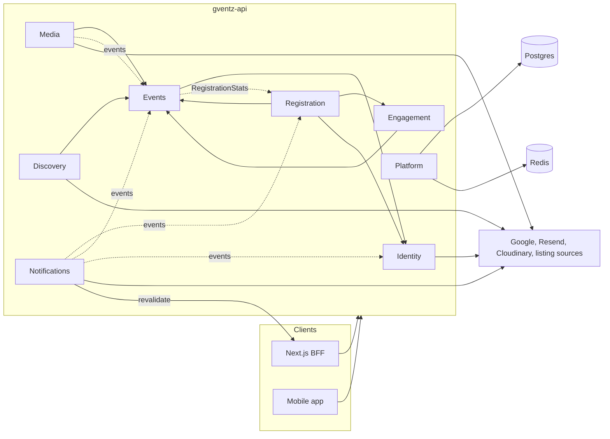

# Component Dependencies

## Dependency matrix

Rows depend on columns. "P" means through the column module's public interface (`index.ts`). "E" means it subscribes to the column module's domain events. Every module depends on Platform and Shared.

| Depends on → | Identity | Events | Engagement | Registration | Media | Discovery | Notifications |
|---|---|---|---|---|---|---|---|
| **Identity** | — | | | | | | |
| **Events** | P (guard, `CurrentUser`) | — | | P (`RegistrationStats`) | | | |
| **Engagement** | P | P (permission guard) | — | | | | |
| **Registration** | P (`UserDirectory`) | P (permission guard, `EventAccessService`) | P (`QuestionCatalog`) | — | | | |
| **Media** | P | P (`EventCoverPort`, guard), E (`EventDeleted`) | | | — | | |
| **Discovery** | P | P (`EventQueryService`) | | | | — | |
| **Notifications** | P (`UserDirectory`), E | P (`EventSummaryReader`), E | E | E | E | | — |

- **No cycles.** Events reads `RegistrationStats` through an interface that Registration implements. NestJS wiring uses an injection token, so Events has no compile-time import of Registration internals.
- **Identity depends on nothing.** Notifications depends on everything only through events and read interfaces. Nothing depends on Notifications.

## Communication patterns

| Pattern | Used for | Mechanism |
|---|---|---|
| Synchronous call through a public interface | Reads and checks needed to finish a request (permissions, questions, user contact) | NestJS DI with exported providers |
| In-process domain event, after commit | Side effects that must not slow or undo the request | `DomainEventBus` |
| Durable job | Email, cache revalidation, file cleanup | BullMQ on Redis, retries with exponential backoff, deterministic job ids |
| HTTP to the outside | Google, Resend, Cloudinary, Places, listing sources, Next.js revalidation | Adapters behind interfaces, timeouts on every call |

## Module dependency diagram



Text alternative: the Next.js backend-for-frontend and the mobile app call the API. Inside the API, Events uses Identity; Engagement uses Events; Registration uses Events, Engagement and Identity; Media and Discovery use Events. Notifications subscribes to events from Registration, Events and Identity, and Media subscribes to Events' deletion event. Events reads registration counts through an interface that Registration implements. Platform connects to Postgres and Redis. Identity, Media, Discovery and Notifications call outside services. Notifications calls back to Next.js to refresh cached pages.

## Data ownership

Each table has one module that writes it. Other modules read through public interfaces or read-side queries.

| Table | Writer | Readers |
|---|---|---|
| `users`, `user_identities`, `profiles`, `sessions`, `sign_in_codes` | Identity | Notifications (contact via `UserDirectory`) |
| `events` (definition columns), `ticket_tiers` (definition columns), `event_members` | Events | Registration, Discovery, Notifications, Media (cover via `EventCoverPort`) |
| `events.active_count`, `ticket_tiers.sold` (counters) | Registration | Events (read side) |
| `event_questions`, `email_campaigns` | Engagement | Registration (via `QuestionCatalog`) |
| `registrations` | Registration | Events (via `RegistrationStats`), Notifications |
| `email_suppressions`, `audit_log` | Notifications / Platform | — |
| `places_usage` | removed; replaced by Redis counters | — |

`events.active_count` is new (confirmed + pending). Functional Design for U4 confirms it. U6 backfills it during migration.

## Data flow: register and receive a ticket

```text
Browser -> Next.js action -> POST /v1/events/{id}/registrations
  AccessTokenGuard -> RegistrationService.register
    [tx] lock event -> check duplicate -> validate answers -> admit -> insert registration
  commit -> RegistrationConfirmed -> TicketEmailHandler -> email queue
  201 { status, ticketCode } -> Next.js redirects to /t/{code}
Worker: EmailProcessor -> EmailComposer (QR PNG) -> ResendMailer (Idempotency-Key)
Worker: RevalidationProcessor -> POST gventz.com/api/revalidate (HMAC) -> tag event:{slug}
```
