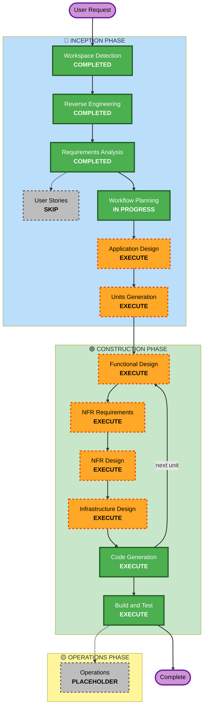

# Execution Plan

Based on: `requirements.md` (approved 2026-10-23), reverse-engineering artifacts, and the user's confirmation "typescript oop" (TypeScript strict, object-oriented NestJS, as in D1 and D6).

## Detailed Analysis Summary

### Transformation Scope (Brownfield)
- **Transformation Type**: Architectural. The backend moves from a Next.js monolith with logic in Supabase to a separate NestJS service.
- **Primary Changes**:
  - New NestJS 11 backend repository (TypeScript strict, OOP: modules, controllers, services, domain entities, repository interfaces with Drizzle implementations).
  - Supabase Postgres, Auth and Storage replaced by Render Postgres, NestJS auth (Google OIDC + email code) and Cloudinary.
  - Business rules move out of the 16 PL/pgSQL functions and RLS policies into domain and service classes.
  - Next.js becomes a frontend and backend-for-frontend that calls the API.
- **Related Components**:
  - This repo (Next.js): every Server Action, `src/lib/supabase/*`, `src/lib/auth.ts`, middleware, `/api/places/*`, sign-in pages, upload code.
  - New infrastructure: Render web service, Render Postgres, Render Redis, Cloudinary, Resend sender domain, Google OAuth client, DNS.
  - Data: one-time migration from `gvents-prod` (rehearsed on `gvents-staging`).

### Change Impact Assessment
- **User-facing changes**: Yes. New "Continue with Google" sign-in. Everything else keeps today's behaviour (BT1–BT14); three bugs fixed (C1–C3).
- **Structural changes**: Yes. One application becomes two deployables in two repositories.
- **Data model changes**: Yes, moderate. Same tables and ids; new tables for users, identities, sessions and sign-in codes (replacing `auth.*`); RLS and PL/pgSQL functions removed.
- **API changes**: Yes. New REST API with OpenAPI; Server Actions call it instead of Supabase.
- **NFR impact**: Yes. p95 targets, concurrency-safe registration, Redis caching and queues, stateless scale-out.

### Component Relationships
- **Primary Component**: new NestJS backend repository (name pending, O2).
- **Infrastructure Components**: Render blueprint (`render.yaml`): web service, Postgres, Redis. Vercel project (region `fra1`).
- **Shared Components**: OpenAPI document, generated TypeScript client used by Next.js (and later mobile).
- **Dependent Components**: Next.js app in this repo; later the mobile app.
- **Supporting Components**: Resend, Cloudinary, Google OAuth, Ticketmaster/PredictHQ/iCal, Google Places.

| Component | Change Type | Reason | Priority |
|---|---|---|---|
| NestJS backend (new) | Major | New system | Critical |
| Render infrastructure (new) | Major | Hosting, DB, Redis | Critical |
| Data migration scripts (new) | Major | Move users, events, tickets, flyers | Critical |
| Next.js app (this repo) | Major | Replace Supabase calls with API calls, new auth flow | Critical |
| Supabase projects | Configuration | Read-only at cutover, then retired | Important |

### Risk Assessment
- **Risk Level**: High. System-wide change, auth replaced, live data migrated, tight dates.
- **Rollback Complexity**: Moderate. Until Supabase is retired, rollback is pointing Vercel back at the current build; writes made after cutover would need replaying.
- **Testing Complexity**: Complex. Concurrency, auth flows, data migration verification, property-based tests.

## Workflow Visualization

Text alternative: Workspace Detection, Reverse Engineering and Requirements Analysis are complete. User Stories is skipped. Workflow Planning leads to Application Design, then Units Generation. Each unit then goes through Functional Design, NFR Requirements, NFR Design, Infrastructure Design (each at the depth that unit needs, skipped per unit where nothing applies) and Code Generation, looping to the next unit. After the last unit, Build and Test runs. Operations is a placeholder.

## Phases to Execute

### 🔵 INCEPTION PHASE
- [x] Workspace Detection (COMPLETED)
- [x] Reverse Engineering (COMPLETED)
- [x] Requirements Analysis (COMPLETED, approved 2026-10-23)
- [x] User Stories (SKIPPED)
  - **Rationale**: Behaviour is parity with BT1–BT14, already documented. The one new user-facing feature (Google sign-in) has acceptance rules in FR-1. The user approved requirements without adding the stage.
- [x] Execution Plan (IN PROGRESS)
- [ ] Application Design - EXECUTE
  - **Rationale**: A whole new backend. Components (NestJS modules), their services and repository interfaces, domain entities and dependencies between modules all need defining. This is where the OOP structure is fixed.
- [ ] Units Generation - EXECUTE
  - **Rationale**: Work spans two repositories, infrastructure and a data migration, and must be ordered so M1's core flows land first.

### 🟢 CONSTRUCTION PHASE (per unit; depth adapts per unit)
- [ ] Functional Design - EXECUTE
  - **Rationale**: Business rules move from PL/pgSQL and RLS into domain classes (registration invariants, roles, check-in, auth linking). The PBT extension needs testable properties identified here.
- [ ] NFR Requirements - EXECUTE (only for units with NFR concerns: platform foundation, identity, registration)
  - **Rationale**: Per-unit performance, concurrency and token-security targets. Stack is mostly decided, so this stays short.
- [ ] NFR Design - EXECUTE (same units)
  - **Rationale**: Row locks and counters for registration, Redis caching and rate limits, queue retries and idempotency, token rotation.
- [ ] Infrastructure Design - EXECUTE (foundation unit and migration unit only)
  - **Rationale**: Render blueprint, Postgres, Redis, environment variables, Vercel region, DNS, migration runbook.
- [ ] Code Generation - EXECUTE (ALWAYS)
  - **Rationale**: Implementation, tests and generated client.
- [ ] Build and Test - EXECUTE (ALWAYS)
  - **Rationale**: Coverage, integration, concurrency and PBT gates before M3.

### 🟡 OPERATIONS PHASE
- [ ] Operations - PLACEHOLDER
  - **Rationale**: Cutover runbook is covered in the migration unit's Infrastructure Design.

## Proposed Unit Sequence (final split decided in Units Generation)

| # | Unit | Repository | Milestone |
|---|---|---|---|
| U1 | Platform foundation: scaffold, config, Drizzle schema, error mapping, logging, health, Redis, BullMQ, OpenAPI, test harness, Render blueprint | Backend | M1 |
| U2 | Identity: users, email code, Google OIDC, sessions and refresh tokens, guards, event-role policy | Backend | M1 |
| U3 | Events: events, tiers, questions, members and roles, flyers (Cloudinary) | Backend | M1 (create event), rest M2 |
| U4 | Registration and ticketing: register, waiting list, tickets, check-in, email queue | Backend | M1 (register, ticket, check-in), rest M2 |
| U5 | Discovery and dashboard: public reads, outside listings, venue search, revalidation webhook, dashboard queries | Backend | M2 |
| U6 | Data migration: Supabase to Render Postgres, flyers to Cloudinary, verification, cutover runbook | Backend | M2 rehearsal, M3 |
| U7 | Frontend integration: BFF auth cookies, generated client, replace every Supabase call | This repo | M2 |

Sequence: U1 → U2 → U3 → U4 is the critical path for M1. U5 and U6 can proceed in parallel once U3 is done. U7 starts once the U2 contract is stable and finishes after U5.

## Coordination
- **Update Approach**: Hybrid. Backend first (sequential on the critical path), frontend integration once API contracts are stable.
- **Critical Path**: U1, U2 (auth contract is needed by every other unit and by U7).
- **Coordination Points**: OpenAPI document and generated client; revalidation webhook contract; shared user ids from migration.
- **Testing Checkpoints**: M1 end-to-end smoke against a staging copy; M2 full parity on staging; M3 gates (80% coverage, PBT, concurrency) before cutover.
- **Rollback**: Supabase stays intact and read-only until M3 is verified; Vercel keeps the previous deployment for instant rollback.

## Blockers to Start Code Generation
- **O2 (repository name)**: needed before U1 code. Until it is provisioned, the backend can be scaffolded in a sibling folder (`/Users/payazaafrica/gventz-api`) and pushed once the repository exists.
- **O4, O5, O6, O7**: needed to run U2 (Google, Resend), U3 (Cloudinary) and U1 (Render) against real services. Code can be written and tested locally without them.

## Estimated Timeline
- **Total stages remaining**: Application Design, Units Generation, 7 units through the Construction loop, Build and Test.
- **M1 (2026-10-24)**: U1, U2 and the core paths of U3 and U4. Achievable only if design approvals come back quickly; depth for these units is kept to what the code needs.
- **M2**: U3–U5 complete, U6 rehearsed on staging, U7 complete. Target end of October.
- **M3 (by 2026-11-15)**: Build and Test gates, production migration, cutover.

## Success Criteria
- **Primary Goal**: G-ventZ runs on a TypeScript OOP NestJS API on Render with PostgreSQL, Google sign-in, and no Supabase dependency.
- **Key Deliverables**: Backend repository, Render blueprint, OpenAPI and generated client, migration scripts and runbook, Next.js app on the API.
- **Quality Gates**: 80% line coverage; integration tests on real Postgres; registration concurrency test; property-based tests (fast-check); migration row counts match; p95 targets met on staging.
- **Integration Testing**: Next.js and API working together on staging for every BT1–BT14 flow.
- **Operational Readiness**: Structured logs, health endpoint, daily backups confirmed.
