# Execution Plan — Change 1 (version 2)

Version 1 is kept in `execution-plan-v1-superseded.md`.

Based on:
- `requirements.md` revision 2.1, approved 2026-10-24
- `user-stories/stories.md` (45 stories) and `personas.md`, approved 2026-10-24
- reverse-engineering artifacts
- the work already done: U1 and U2 code in `gventz-api`, and the U3 functional design

## Detailed Analysis Summary

### Transformation Scope (Brownfield)
- **Transformation type:** architectural. The backend moves out of Next.js into a NestJS service, and the data stays in Supabase. New payment capability is added.
- **Primary changes:**
  - **NestJS API** (`gventz-api`) on Render. It connects to Supabase Postgres through the pooler and trusts Supabase Auth tokens. Business rules live in domain and service classes.
  - **Next.js app** (`feature/backend-split`) calls the API from the server for all data. Supabase is used only for sign-in.
  - **Schema changes** stay in `supabase/migrations/` in this repository:
    - several tickets per purchase (orders)
    - the per-buyer limit
    - the fee choice
    - later, payments tables (orders, holds, ledger, payout accounts)
  - **Payments** (M4/M5): Paystack, then Stripe, with a split per sale.
  - **Operations:** Grafana Cloud, Sentry, autoscaling, rolling deploys, load test and restore drill.
- **Related components:**
  - **This repository:**
    - every Server Action
    - `src/lib/supabase/*` (reduced to sign-in)
    - `src/lib/auth.ts`
    - `/api/places/*`, which moves to the API
    - sign-in pages (Google), the register form (quantities), the dashboard (sales and orders later), and the check-in scanner
  - **`gventz-api`:**
    - U1 platform (reuse with changes)
    - U2 identity (replace with a Supabase token adapter)
    - new modules
  - **Outside services:**
    - Supabase project settings: Google provider, custom SMTP through Resend, MFA, Turnstile, pooler, point-in-time recovery
    - Render, Grafana Cloud, Sentry
    - later Paystack and Stripe

### Change Impact Assessment
- **User-facing changes:** yes.
  - Google sign-in.
  - Buying several tickets at once.
  - Faster check-in.
  - Later: paid checkout, payout accounts, refunds, sales.
- **Structural changes:** yes. One deployable becomes two (Vercel and Render), plus a background worker.
- **Data model changes:** yes. These are additive migrations in `supabase/migrations/`:
  - M3: tickets linked to a purchase, guest names, the per-buyer limit
  - M4: orders, holds, ledger, payout accounts, fee settings, fee choice
  - Existing tables and ids are unchanged.
- **API changes:** yes. A new REST API with OpenAPI and a generated client. Server Actions call the API.
- **NFR impact:** yes, high:
  - 20,000 tickets a day, with bursts of 50 a second
  - 99.9% availability, recovery within 1 hour, at most 2 minutes of data lost
  - Security and Resiliency baselines
  - property-based testing

### Component Relationships

| Component | Change type | Reason | Priority |
|---|---|---|---|
| `supabase/migrations` (this repo) | Minor, additive | New columns and tables for orders and limits (M3), payments (M4) | Critical |
| `gventz-api` U1 platform | Major rework | Supabase pooler; no own migrations; OpenTelemetry; autoscaling | Critical |
| `gventz-api` identity | Replace | Supabase token adapter instead of own auth (U2 parked on a branch) | Critical |
| `gventz-api` events, registration, check-in | New | Business rules move from Server Actions and SQL functions | Critical |
| `gventz-api` payments | New | Paystack, then Stripe | Important (M4/M5) |
| Next.js app (this repo) | Major | Server Actions call the API; Google button; quantities; scanner | Critical |
| Supabase project configuration | Configuration | Google, SMTP, MFA, Turnstile, point-in-time recovery, pooler, region (O9) | Critical |
| Render, Grafana, Sentry | New infrastructure | Hosting, monitoring, alerts | Critical |

### Risk Assessment
- **Risk level:** **High.**
  - Hard deadline (2026-11-15) for a 20,000-guest event.
  - System-wide change, with real money later.
  - Lower than version 1, because no data migration or auth replacement is needed.
- **Rollback complexity:** easy to moderate.
  - Same database, so the old Next.js build (on `main`) can be redeployed on Vercel at any time while migrations stay additive.
  - Payments roll back by switching paid checkout off.
- **Testing complexity:** complex.
  - concurrency and load tests
  - property-based tests
  - webhook and sandbox tests (M4)
  - a restore drill

## Workflow Visualization

```mermaid
flowchart TD
    Start(["Change 1 request"])

    subgraph INCEPTION["🔵 INCEPTION PHASE"]
        WD["Workspace Detection<br/><b>COMPLETED</b>"]
        RE["Reverse Engineering<br/><b>COMPLETED</b>"]
        RA["Requirements Analysis<br/><b>COMPLETED</b>"]
        US["User Stories<br/><b>COMPLETED</b>"]
        WP["Workflow Planning<br/><b>IN PROGRESS</b>"]
        AD["Application Design<br/><b>EXECUTE - revise</b>"]
        UG["Units Generation<br/><b>EXECUTE - revise</b>"]
    end

    subgraph CONSTRUCTION["🟢 CONSTRUCTION PHASE"]
        FD["Functional Design<br/><b>EXECUTE per unit</b>"]
        NFRA["NFR Requirements<br/><b>EXECUTE per unit</b>"]
        NFRD["NFR Design<br/><b>EXECUTE per unit</b>"]
        ID["Infrastructure Design<br/><b>EXECUTE per unit</b>"]
        CG["Code Generation<br/><b>EXECUTE</b>"]
        BT["Build and Test<br/><b>EXECUTE</b>"]
    end

    subgraph OPERATIONS["🟡 OPERATIONS PHASE"]
        OPS["Operations<br/><b>PLACEHOLDER</b>"]
    end

    Start --> WD
    WD --> RE
    RE --> RA
    RA --> US
    US --> WP
    WP --> AD
    AD --> UG
    UG --> FD
    FD --> NFRA
    NFRA --> NFRD
    NFRD --> ID
    ID --> CG
    CG -->|next unit| FD
    CG --> BT
    BT -.-> OPS
    BT --> End(["Complete"])

    style WD fill:#4CAF50,stroke:#1B5E20,stroke-width:3px,color:#fff
    style RE fill:#4CAF50,stroke:#1B5E20,stroke-width:3px,color:#fff
    style RA fill:#4CAF50,stroke:#1B5E20,stroke-width:3px,color:#fff
    style US fill:#4CAF50,stroke:#1B5E20,stroke-width:3px,color:#fff
    style WP fill:#4CAF50,stroke:#1B5E20,stroke-width:3px,color:#fff
    style AD fill:#FFA726,stroke:#E65100,stroke-width:3px,stroke-dasharray: 5 5,color:#000
    style UG fill:#FFA726,stroke:#E65100,stroke-width:3px,stroke-dasharray: 5 5,color:#000
    style FD fill:#FFA726,stroke:#E65100,stroke-width:3px,stroke-dasharray: 5 5,color:#000
    style NFRA fill:#FFA726,stroke:#E65100,stroke-width:3px,stroke-dasharray: 5 5,color:#000
    style NFRD fill:#FFA726,stroke:#E65100,stroke-width:3px,stroke-dasharray: 5 5,color:#000
    style ID fill:#FFA726,stroke:#E65100,stroke-width:3px,stroke-dasharray: 5 5,color:#000
    style CG fill:#4CAF50,stroke:#1B5E20,stroke-width:3px,color:#fff
    style BT fill:#4CAF50,stroke:#1B5E20,stroke-width:3px,color:#fff
    style OPS fill:#BDBDBD,stroke:#424242,stroke-width:2px,stroke-dasharray: 5 5,color:#000
    style Start fill:#CE93D8,stroke:#6A1B9A,stroke-width:3px,color:#000
    style End fill:#CE93D8,stroke:#6A1B9A,stroke-width:3px,color:#000
    style INCEPTION fill:#BBDEFB
    style CONSTRUCTION fill:#C8E6C9
    style OPERATIONS fill:#FFF59D

    linkStyle default stroke:#333,stroke-width:2px
```

Text alternative:
- **Inception:** Workspace Detection, Reverse Engineering, Requirements Analysis and User Stories are complete. Workflow Planning is in progress. It leads to Application Design and Units Generation, both revising the version 1 documents.
- **Construction:** each unit goes through Functional Design, NFR Requirements, NFR Design and Infrastructure Design, as far as that unit needs (see the per-unit table), then Code Generation. Then the next unit starts.
- **After the last unit:** Build and Test runs. Operations is a placeholder.

## Phases to Execute

### 🔵 INCEPTION PHASE
- [x] Workspace Detection (COMPLETED)
- [x] Reverse Engineering (COMPLETED; still valid, same database)
- [x] Requirements Analysis (COMPLETED, revision 2.1)
- [x] User Stories (COMPLETED, 45 stories)
- [x] Workflow Planning (IN PROGRESS)
- [ ] **Application Design: EXECUTE (revise version 1, standard depth)**
  - **Rationale:** the version 1 design assumed its own auth, Render Postgres and Cloudinary. The revision covers:
    - Identity → a Supabase token adapter
    - Media → Supabase Storage
    - Registration → several tickets per purchase
    - a new **Payments** module (orders, holds, `PaymentProvider` with Paystack and Stripe adapters, webhooks, refunds, ledger, payout accounts, fees)
    - platform staff permissions
    - the monitoring components
  - **Kept:** the U3 design and the module and layer rules.
- [ ] **Units Generation: EXECUTE (revise)**
  - **Rationale:** the units change: data migration is gone, payments are new, and work splits across the M3 go-live and the M4/M5 payment milestones.

### 🟢 CONSTRUCTION PHASE
Stages execute per unit, depending on what each unit needs (see the next section). Code Generation and Build and Test always run.
- **Functional Design:** EXECUTE for units with new business rules.
- **NFR Requirements and NFR Design:** EXECUTE for platform, registration and check-in (scale), and payments (security and resiliency). Required by the Security and Resiliency extensions where they apply.
- **Infrastructure Design:** EXECUTE for platform (Render, Supabase, Grafana and Sentry, autoscaling, region) and payments (webhook endpoints, keys, provider settings).
- **Code Generation:** EXECUTE (ALWAYS).
- **Build and Test:** EXECUTE (ALWAYS). It includes the load test at 100 a second, the restore drill and the coverage gates.

### 🟡 OPERATIONS PHASE
- [ ] Operations: PLACEHOLDER. Runbooks, the incident process (D52) and the December pre-scale are produced inside the platform unit and Build and Test.

## Proposed Units and Per-Unit Stages (final split in Units Generation)

| # | Unit | Repository | FD | NFR Req | NFR Design | Infra | Milestone |
|---|---|---|---|---|---|---|---|
| U1 | **Platform (revise):** Supabase pooler, schema from Supabase, OpenTelemetry/Grafana/Sentry, autoscaling, rolling deploys, region | gventz-api | Skip (approved FD still holds) | Revise | Revise | **Revise** | M1 |
| U2 | **Identity (replace):** Supabase token adapter (signing keys), current user, MFA level (`aal2`) check, platform staff role. Own-auth code moves to a branch. | gventz-api | Light | Skip (covered by U1 and SECURITY rules) | Skip | Skip | M1 |
| U3 | **Events and Engagement:** approved FD plus a delta: per-buyer limit, fee choice, paid types gated on payout account | gventz-api | **Delta only** | Skip | Skip | Skip | M1 (create, publish, page), M2 (rest) |
| U4 | **Registration, Tickets and Check-in:** several tickets per purchase, approval, waitlist, scanner endpoint, ticket emails, no-oversell at bursts. Schema migration in this repo. | both | Execute | Execute | Execute | Skip | M1 (core), M2 (groups and waitlist) |
| U5 | **Media, Discovery and Revalidation:** flyers on Supabase Storage, discover, outside feeds, places, signed revalidation | gventz-api | Light | Skip | Skip | Skip | M2 |
| U6 | **Frontend switch:** Server Actions to API, Google button, quantity picker, scanner screen, security headers and CSP | this repo | Skip (stories are enough) | Skip | Skip | Skip | M1 to M2 |
| U7 | **Payments: Paystack:** orders and holds, Paystack adapter, webhooks, fees, payout accounts (subaccounts), refunds, disputes, ledger, reconciliation, MFA step-up, frontend screens | both | Execute | Execute | Execute | Execute | M4 |
| U8 | **Payments: Stripe:** Stripe adapter, Connect Express, Checkout, webhooks, reverse transfers | both | Delta | Delta | Delta | Delta | M5 |

**Sequence:**
1. U1 → U2 → U4 core is the critical path for M1.
2. U3's pass 1 runs alongside U4, since registration needs events.
3. U6 starts once the first API contracts exist, and runs in parallel through M2.
4. U5 runs in M2.
5. **Build and Test for go-live (M3)** runs after U1–U6.
6. U7, then U8, after go-live.

## Module Update Strategy
- **Update approach:** hybrid, in four steps:
  1. Schema migrations (this repository) go first, applied to staging before production. They are additive only.
  2. Then the API.
  3. Then the frontend.
  4. The frontend switches on its branch, and `main` stays deployable until go-live.
- **Critical path:** U1 → U2 → U4, plus the Supabase settings (O17: Google, SMTP) and O9 (region).
- **Coordination points:**
  - The OpenAPI document generates the Next.js client.
  - The Drizzle schema is generated from Supabase, and CI checks it matches.
  - The revalidation contract.
  - Later, webhook URLs in the Paystack and Stripe dashboards.
- **Testing checkpoints:**
  - **M1:** end-to-end smoke on staging.
  - **M2:** parity, load test and alerts.
  - **M3:** coverage, PBT, concurrency, restore drill, then go-live.
  - **M4/M5:** sandbox end-to-end, then go live per provider.
- **Rollback:**
  - Redeploy the previous Vercel build (the old Server Actions still work against the same database).
  - Render rollback for the API.
  - Migrations are never destructive before go-live is confirmed.

## Work Carried Over

| Item | Fate |
|---|---|
| U1 code (gventz-api) | Reused; reworked in U1 (revise) |
| U2 code (own auth) | Moved to branch `parked/own-auth` once the repo has its first commit (commit needs your go-ahead) |
| `drizzle/0000_baseline.sql`, `0001_identity.sql` | Removed. Supabase migrations are the only source of schema changes. |
| U3 functional design | Kept; a short delta in U3 FD |
| U3 code generation plan (not approved) | Withdrawn; redone after Units Generation |
| Version 1 U6 (data migration) | Dropped (same database) |

## Estimated Timeline
- **Remaining stages:** Application Design, Units Generation, 8 units through Construction, and Build and Test.
- **Dates:**

  | Milestone | Date | Work |
  |---|---|---|
  | M1 | 2026-11-01 | U1, U2, U3 pass 1, U4 core, U6 for those flows |
  | M2 | 2026-11-08 | U3 rest, U4 rest, U5, U6 complete, load test, alerts |
  | M3 | 2026-11-15 | Build and Test gates, restore drill, production go-live |
  | M4 | 2026-11-29 | U7 Paystack |
  | M5 | 2026-12-18 | U8 Stripe |

- **Schedule risk:** M1–M3 leave about 3 weeks for the split and the scale work. Design depth for U1–U6 is kept to what the code needs, and approvals need to come back quickly.

## Success Criteria
- **Primary goal:** G-ventZ runs on an object-oriented NestJS API on Render, with Supabase for data, sign-in and storage. It is ready for a free 20,000-guest event by 2026-11-15, then takes payments through Paystack and Stripe.
- **Key deliverables:**
  - the `gventz-api` repository and Render blueprint
  - additive Supabase migrations
  - OpenAPI and the generated client
  - the Next.js app on the API (`feature/backend-split`)
  - dashboards, alerts and runbooks
  - later, the payments module
- **Quality gates:**
  - 80% line coverage
  - integration tests on real Postgres with the Supabase schema
  - no oversell under the concurrency test and the load test at 100 a second
  - p95 targets met
  - PBT rules
  - Security and Resiliency compliance per stage
  - restore drill passed
  - for payments: sandbox end-to-end, webhook signature, replay and out-of-order tests, ledger properties
- **Integration testing:** Next.js and the API together on staging, for every Must story.
- **Operational readiness:** Grafana dashboards and alerts to on-call (O10), Sentry, runbooks, pre-scale plan for the December sales opening.
