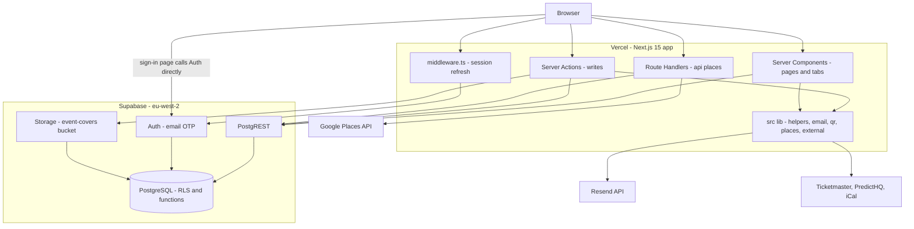
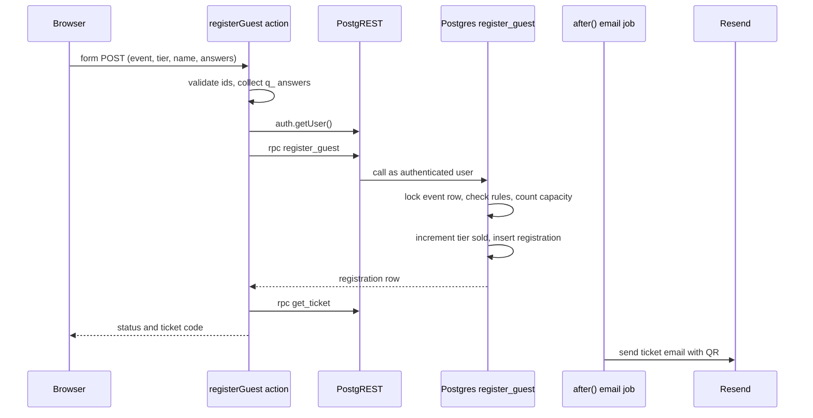

# System Architecture

## System Overview

G-ventZ is a single Next.js 15 (App Router) application deployed on Vercel. There is no separate backend service: the server side is made of React Server Components (reads), Server Actions (writes) and two Route Handlers (`/api/places/*`). Supabase supplies four things at once: the PostgreSQL database, authentication (email one-time code, session cookies), file storage (flyers), and the PostgREST HTTP layer the app uses to query the database.

Business rules are split across two places:

- **TypeScript Server Actions** parse and validate form input, then call the database.
- **PostgreSQL** is the authority for permissions and invariants: row-level security (RLS) policies keyed on `auth.uid()`, a trigger that guards event updates (`events_guard`), and `security definer` functions for multi-step writes (`register_guest`, `create_event_with_tiers`, `check_in_guest`, `promote_next_waitlisted`, `delete_event`, `get_event_page`, `get_ticket`, `take_places_quota`).

There are no classes, services or repositories. Pages, tab components and actions each create a Supabase client and query tables or call functions directly.

## Architecture Diagram

Text alternative: the browser reaches Next.js middleware (which refreshes the Supabase session), Server Components, Server Actions and the Places route handlers. The sign-in page talks to Supabase Auth directly from the browser. Server code reaches Postgres through PostgREST and uploads flyers to Supabase Storage. Server code also calls Google Places, Resend, and the outside event sources.

## Component Descriptions

### Next.js app (`src/app`)
- **Purpose**: Every page, every write, and the HTTP API.
- **Responsibilities**: Rendering, form handling, validation, redirects and status messages, caching (home page ISR 60 s, outside listings 1 h).
- **Dependencies**: `src/lib`, `@supabase/ssr`, `@supabase/supabase-js`.
- **Type**: Application

### Shared library (`src/lib`)
- **Purpose**: Helpers used by pages and actions.
- **Responsibilities**: Supabase client factories (server with cookies, cookieless public, browser), auth guards, form parsing, dates and time zones, locations, themes, QR (SVG and PNG, no dependency), ticket formatting, email (Resend over HTTP), Google Places client, outside listings.
- **Dependencies**: Supabase SDK, `next/headers`, `next/server`.
- **Type**: Shared module

### Supabase PostgreSQL (`supabase/migrations`)
- **Purpose**: Data and the final word on permissions.
- **Responsibilities**: 10 tables, RLS policies, 16 functions (3 of them trigger functions), 3 triggers, storage policies.
- **Dependencies**: Supabase `auth` schema (`auth.users`, `auth.uid()`), `storage` schema.
- **Type**: Data store

### Supabase Auth
- **Purpose**: Accounts and sessions.
- **Responsibilities**: Email OTP issue and verify, JWT session in `sb-*` cookies, refresh. A trigger copies each new `auth.users` row into `public.profiles`.
- **Type**: Managed service

### Supabase Storage
- **Purpose**: Event flyers.
- **Responsibilities**: Public `event-covers` bucket, write access limited to event managers by storage policies that call `can_manage_event_folder`.
- **Type**: Managed service

## Data Flow

### Guest registration (BT5, BT6)

Text alternative: the action validates input, confirms the user, and calls `register_guest`. The function locks the event row, applies every rule, counts current registrations against capacity, bumps the tier counter and inserts the registration. The action reads the ticket, responds, and sends the email after the response.

### Request authentication

1. `middleware.ts` runs on every non-static route. Requests with no `sb-*` cookie skip it; otherwise it calls `supabase.auth.getUser()` (a network call to Supabase Auth) and rewrites refreshed cookies.
2. Pages and actions create a cookie-bound Supabase client and call `auth.getUser()` again.
3. `requireEventRole` then calls `has_event_role` over PostgREST before any dashboard work.
4. Every query re-applies RLS, which calls `has_event_role` again per policy evaluation.

## Integration Points

- **External APIs**:
  - Google Places (New): Autocomplete and Place Details, server-side only, session tokens for billing, per-user quota in Postgres.
  - Resend: transactional email over HTTPS, 10 s timeout, inline PNG QR attachment.
  - Ticketmaster Discovery, PredictHQ, iCal feeds: optional outside listings, 4 s timeout, cached 1 hour.
- **Databases**: Supabase PostgreSQL — `gvents-staging` and `gvents-prod`, both eu-west-2.
- **Third-party Services**: Supabase Auth, Supabase Storage, Vercel hosting.

## Infrastructure Components

- **CDK / Terraform / CloudFormation**: None. Infrastructure is configured in the Vercel and Supabase dashboards.
- **Deployment Model**: Vercel. Each pull request gets a preview (staging Supabase keys); merging to `main` deploys production. Migrations are pushed by hand with the Supabase CLI, staging first.
- **Networking**: Public managed endpoints only. No VPC, no private networking, no connection pooler configuration in the repo.
- **CI**: GitHub Actions — lint, typecheck, unit tests, build; a second job starts a throwaway Supabase, applies every migration, runs `supabase db lint` and the pgTAP tests, and fails if `database.types.ts` is stale.
