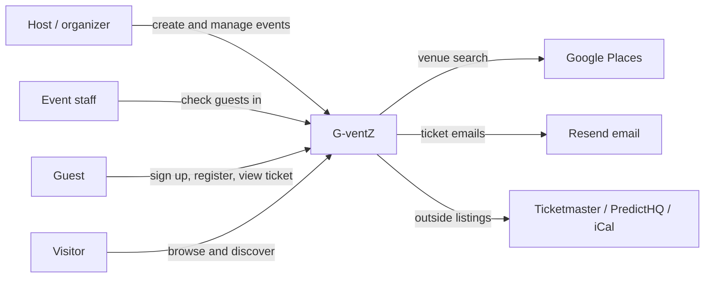

# Business Overview

## Business Context Diagram

Text alternative: hosts, staff, guests and visitors use G-ventZ. G-ventZ calls Google Places for venue search, Resend for ticket emails, and Ticketmaster, PredictHQ and iCal feeds for outside event listings.

## Business Description

- **Business Description**: G-ventZ lets anyone create an event page, take free registrations with custom questions, cap attendance with a waiting list, email each confirmed guest a QR ticket, and check guests in at the door by scanning that QR code. Visitors browse G-ventZ events by category and see outside events from other platforms. Paid tickets are modelled but switched off until payments exist. The main market is Nigeria (NGN, Africa/Lagos default) but events can be anywhere.

- **Business Transactions**:

| # | Transaction | Who | What happens |
|---|---|---|---|
| BT1 | Sign up / sign in | Anyone | Email, then a 6-digit code. The first sign-in creates the account and a profile. |
| BT2 | Create event | Host | Title, category, dates, location (Google Places or typed), ticket types, visibility, approval, refund policy, cover theme. Saved as draft or published in one transaction with its tickets. |
| BT3 | Manage event settings | Host / admin / editor | Open or close registration, set capacity, edit details, upload or remove a flyer, change theme, toggle public/private and attendee count. |
| BT4 | Configure registration questions | Host / admin / editor | Add or remove up to 30 questions (text, options, social, company, terms, phone, website). |
| BT5 | Register for an event | Signed-in guest | Pick a free ticket, answer questions. The database checks open/closed, sales window, duplicates, required answers, tier stock and event capacity. Result: confirmed, pending (needs approval) or waitlisted. |
| BT6 | Email ticket | System | A confirmed guest gets an HTML email with an inline QR code, sent after the response. |
| BT7 | View ticket | Anyone with the link | `/t/<code>` shows the ticket, its state and a QR code. |
| BT8 | Check in guest | Owner / admin / editor / checkin staff | From the guest list or by scanning the QR. A second check-in is refused. |
| BT9 | Promote from waiting list | Host / admin / editor | Confirms the next waitlisted guest and emails their ticket. |
| BT10 | Draft announcement | Host / admin / editor | Saves an email to a guest segment as a draft. Sending is not built. |
| BT11 | Cancel event | Owner / admin | Marks the event cancelled and closes registration. |
| BT12 | Delete event | Owner only | Typed-name confirmation, refused if any paid registration exists. Removes the flyer files too. |
| BT13 | Discover events | Anyone | G-ventZ public events by category, plus "Happening elsewhere" from outside sources (cached 1 hour). |
| BT14 | Choose dashboard style | Host | Saves a theme to the profile. |

- **Business Dictionary**:

| Term | Meaning |
|---|---|
| Event | A gathering with a slug-based public page. Status `draft`, `published` or `cancelled`; visibility `public` (listed) or `private` (link only). |
| Ticket tier | A ticket type on an event: name, price in minor units, optional quantity, `sold` counter, optional sales window. |
| Registration | One guest's ticket for one event. Status `pending`, `confirmed`, `waitlisted`, `cancelled`, `refunded`. Carries a 24-hex `ticket_code`. |
| Capacity | Optional event-wide cap on confirmed + pending registrations. Past it, new guests are waitlisted. |
| Waiting list | Registrations with status `waitlisted`, promoted one at a time by the host. |
| Event role | `owner`, `admin`, `editor`, `checkin`, `finance`, `viewer`. The owner is `events.owner_id`; others are rows in `event_members` (no UI yet). |
| Registration question | A host-defined form field. Answers are stored keyed by question id, with the label copied in. |
| Campaign / announcement | A drafted email to a guest segment (`all`, `paid`, `checked_in`, `not_checked_in`, `waitlist`). |
| Cover theme | A named visual style (Minimal, Sunset, Ocean, ...) for the event page and the host dashboard. |
| Flyer | An uploaded JPG/PNG/WebP cover image, 5 MB max. |
| Minor units | Integer price in the smallest currency unit (kobo for NGN). |

## Component Level Business Descriptions

### Public site (home, discover, info pages)
- **Purpose**: Bring visitors in and help them find events.
- **Responsibilities**: Featured upcoming events, category browsing, outside listings, pricing/help/legal pages.

### Accounts (sign-in)
- **Purpose**: One account type for hosts and guests.
- **Responsibilities**: Passwordless email code sign-in and sign-up, sign-out, safe return to the page the user came from.

### Event creation
- **Purpose**: Let a signed-in host publish an event quickly.
- **Responsibilities**: Validate the form, resolve the venue, write the event and its ticket types together.

### Host dashboard
- **Purpose**: Run an event after it is created.
- **Responsibilities**: Event list with counts and quick toggles; per-event tabs for overview, guests, registration questions, announcements and settings.

### Registration and tickets
- **Purpose**: Turn interest into a valid, checkable ticket.
- **Responsibilities**: Registration rules, waiting list, ticket page, ticket email, door check-in.

### Venue search
- **Purpose**: Accurate venue, address and coordinates without exposing the Google key.
- **Responsibilities**: Server-side proxy to Google Places with a per-user quota.
