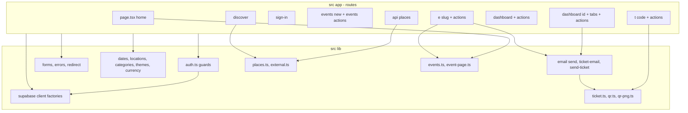

# Code Structure

## Build System
- **Type**: npm, Next.js 15.5.27 build
- **Configuration**:
  - `package.json` — scripts `dev`, `build`, `start`, `lint`, `typecheck`, `test` (Vitest), `test:db` (pgTAP via Supabase CLI), `db:types` / `db:types:local` (generate `database.types.ts`). Node >= 22.
  - `next.config.ts` — security headers on every route; Server Action body limit raised to 6 MB for flyer uploads.
  - `tsconfig.json` — strict TypeScript, `@/*` path alias to `src/*`.
  - `eslint.config.mjs` — `next/core-web-vitals` + `next/typescript`.
  - `vitest.config.ts` — unit tests in `src/**/*.test.ts`.
  - `supabase/config.toml` — local Supabase stack for tests.
  - `.github/workflows/ci.yml` — CI (see architecture.md).

## Key Classes/Modules

The code is procedural. There are two classes in the whole codebase: `PlacesError` (an error type) and an internal `Builder` in `qr.ts`. Modules group functions by feature:

Text alternative: route modules under `src/app` call into `src/lib` for Supabase clients, auth guards, form helpers, domain helpers, ticket/QR, email, external APIs and shared reads.

### Existing Files Inventory

**Backend: data access, auth, actions (primary candidates for the redesign)**
- `src/middleware.ts` — Refreshes the Supabase session cookie; skips requests without `sb-*` cookies and static/info routes.
- `src/lib/supabase/server.ts` — Cookie-bound server client (RLS applies as the signed-in user).
- `src/lib/supabase/public.ts` — Cookieless client for cacheable public reads.
- `src/lib/supabase/client.ts` — Browser client (used only by the sign-in page).
- `src/lib/supabase/database.types.ts` — Generated schema types (515 lines).
- `src/lib/auth.ts` — `requireUser`, `requireEventRole`, role lists.
- `src/lib/errors.ts` — Maps database errors to user messages (`P0001` shown, else generic).
- `src/lib/forms.ts` — `field`, `checkbox`, `isUuid` FormData helpers.
- `src/lib/redirect.ts` — `safeNextPath` open-redirect guard.
- `src/lib/env.ts` — Lazy, validated public env vars.
- `src/lib/events.ts` — `getFeaturedEvents` (public listing query).
- `src/lib/event-page.ts` — `getEventPage` via `get_event_page` RPC.
- `src/lib/ticket.ts` — `getTicket` RPC, ticket formatting, `siteOrigin`.
- `src/lib/places.ts` — Google Places client, `PlacesError`, quota (DB with in-memory fallback).
- `src/lib/external.ts` — Ticketmaster, PredictHQ, iCal fetch and parse.
- `src/lib/email/send.ts` — Resend HTTP client.
- `src/lib/email/send-ticket.ts` — Builds the ticket email and sends it in `after()`.
- `src/lib/email/ticket-email.ts` — Ticket email HTML/text template.
- `src/app/auth/actions.ts` — `signOut`.
- `src/app/events/actions.ts` — `createEvent` (validation, slug, location, tiers, `create_event_with_tiers`).
- `src/app/e/[slug]/actions.ts` — `registerGuest`.
- `src/app/t/[code]/actions.ts` — `checkInFromTicket`.
- `src/app/dashboard/actions.ts` — `updateEventSetting`, `setDashboardTheme`.
- `src/app/dashboard/[id]/actions.ts` — 14 host actions (registration open, capacity, questions, check-in, promote, announcement, details, flyer upload/remove, cancel, delete, theme).
- `src/app/dashboard/[id]/messages.ts` — Status message codes for the dashboard.
- `src/app/dashboard/getTheme.ts` — Reads the profile's dashboard theme.
- `src/app/api/places/autocomplete/route.ts` — `GET /api/places/autocomplete`.
- `src/app/api/places/details/route.ts` — `GET /api/places/details`.
- `src/app/api/places/route-helpers.ts` — Signed-in check, quota, JSON helpers.

**Pages that query the database directly (data access mixed into UI)**
- `src/app/page.tsx` — Home (ISR 60 s, featured events).
- `src/app/discover/page.tsx` — G-ventZ events and outside listings.
- `src/app/sign-in/page.tsx` — Client component; calls Supabase Auth `signInWithOtp` / `verifyOtp` from the browser.
- `src/app/events/new/page.tsx` — Create event page (requires user).
- `src/app/e/[slug]/page.tsx` — Public event page; `get_event_page`, `public_attendee_count`.
- `src/app/t/[code]/page.tsx` — Ticket page.
- `src/app/dashboard/page.tsx` — Host event list with embedded counts.
- `src/app/dashboard/[id]/page.tsx` — Event management shell.
- `src/app/dashboard/[id]/GuestsTab.tsx`, `OverviewTab.tsx`, `RegistrationTab.tsx`, `AnnouncementsTab.tsx`, `SettingsTab.tsx` — Each creates its own Supabase client and queries tables.

**Domain helpers (pure, reusable as-is)**
- `src/lib/dates.ts` — Zoned time to UTC, formatting, default zone.
- `src/lib/locations.ts` — Countries and regions, `fold` for matching.
- `src/lib/categories.ts` — Category list (mirrors a DB check constraint).
- `src/lib/themes.ts` — Theme keys and backgrounds.
- `src/lib/currency.ts` — Pricing-page prices per currency.
- `src/lib/qr.ts`, `src/lib/qr-png.ts` — Dependency-free QR encoder (SVG, PNG).
- `src/lib/tilt-physics.ts` — Home page tilt game physics.

**UI only (no backend impact)**
- `src/app/layout.tsx`, `loading.tsx`, `error.tsx`, `global-error.tsx`, `not-found.tsx`, `manifest.ts`, `fonts.ts`, `globals.css`, `home-ball.css`, `hero-shapes.ts`, `HeroCards.tsx`, `HeroTilt.tsx`, `AccountLink.tsx`
- `src/app/help`, `pricing`, `privacy`, `refunds`, `terms` pages
- `src/app/events/new/NewEventForm.tsx`, `LocationFields.tsx`
- `src/app/e/[slug]/RegisterForm.tsx`
- `src/app/t/[code]/PrintButton.tsx`, `ticket-css.ts`
- `src/app/dashboard/EventRow.tsx`, `ThemePanel.tsx`, `[id]/CopyLink.tsx`, `[id]/DeleteEventForm.tsx`
- `src/components/*` — BackLink, CategoryBrowser, Combobox, ElsewhereEvents, LegalDoc, MirrorBall, OtpInput, PricingPlans, SignOutButton, ThemeStage

**Database**
- `supabase/migrations/20261013000000_baseline.sql` — Tables, RLS, `has_event_role`, `reserve_ticket`, profile trigger.
- `supabase/migrations/20261014000100_reconcile_live_schema.sql` — `event_questions`, `waitlisted`, `register_guest`, `public_attendee_count`, `promote_next_waitlisted`.
- `supabase/migrations/20261014000200_security_hardening.sql` — Private events, `events_guard`, `create_event_with_tiers`, storage policies, one active registration per user.
- `supabase/migrations/20261022000100_ticket_page.sql` — `get_ticket`.
- `supabase/migrations/20261022000200_event_location_details.sql` — Region, country code, place id; `create_event_with_tiers` v2.
- `supabase/migrations/20261022000300_delete_event.sql` — `event_delete_check`, `delete_event`.
- `supabase/migrations/20261022000400_registration_email.sql` — `register_guest` uses the account email.
- `supabase/migrations/20261022000500_places_quota.sql` — `places_usage`, `take_places_quota`.
- `supabase/tests/registration_and_quota.test.sql` — pgTAP tests.

## Design Patterns

### Database as the authority
- **Location**: `supabase/migrations/*`, `src/lib/auth.ts`
- **Purpose**: Permissions cannot be bypassed even if app code is wrong.
- **Implementation**: RLS on every table plus `security definer` functions for multi-step writes. The app duplicates the role check up front only to give a clear 404 or message.

### Transaction script
- **Location**: Each Server Action; each plpgsql function.
- **Purpose**: One procedure per use case.
- **Implementation**: Parse FormData, validate, call one RPC or table write, redirect with a message code.

### Post-redirect-get with message codes
- **Location**: `src/app/dashboard/[id]/actions.ts` (`done`, `fail`), `messages.ts`
- **Purpose**: No false "Saved" messages; refresh-safe.
- **Implementation**: Actions redirect with `?ok=` / `?err=` codes that map to fixed text.

### Background work after response
- **Location**: `src/lib/email/send-ticket.ts`
- **Purpose**: Guests never wait on email; mail failures never undo a registration.
- **Implementation**: `after()` from `next/server`. Not durable: no retry, lost if the function instance dies.

### Cacheable public reads
- **Location**: `src/lib/supabase/public.ts`, `src/app/page.tsx`, `src/lib/external.ts`
- **Purpose**: Home and outside listings don't hit the database or APIs on every visit.
- **Implementation**: Cookieless client + `revalidate` (60 s home, 3600 s outside listings).

## Critical Dependencies

### @supabase/ssr
- **Version**: ^0.12.7
- **Usage**: `middleware.ts`, `lib/supabase/server.ts`, `lib/supabase/client.ts`
- **Purpose**: Cookie-based Supabase sessions in Next.js.

### @supabase/supabase-js
- **Version**: ^2.117.3
- **Usage**: Every data access (`.from`, `.rpc`, `.auth`, `.storage`) in 22 files.
- **Purpose**: Database (PostgREST), auth and storage client.

### next
- **Version**: 15.5.27
- **Usage**: Whole app; `after`, `revalidatePath`, `redirect`, `cookies`, `headers`.
- **Purpose**: Framework and runtime.
