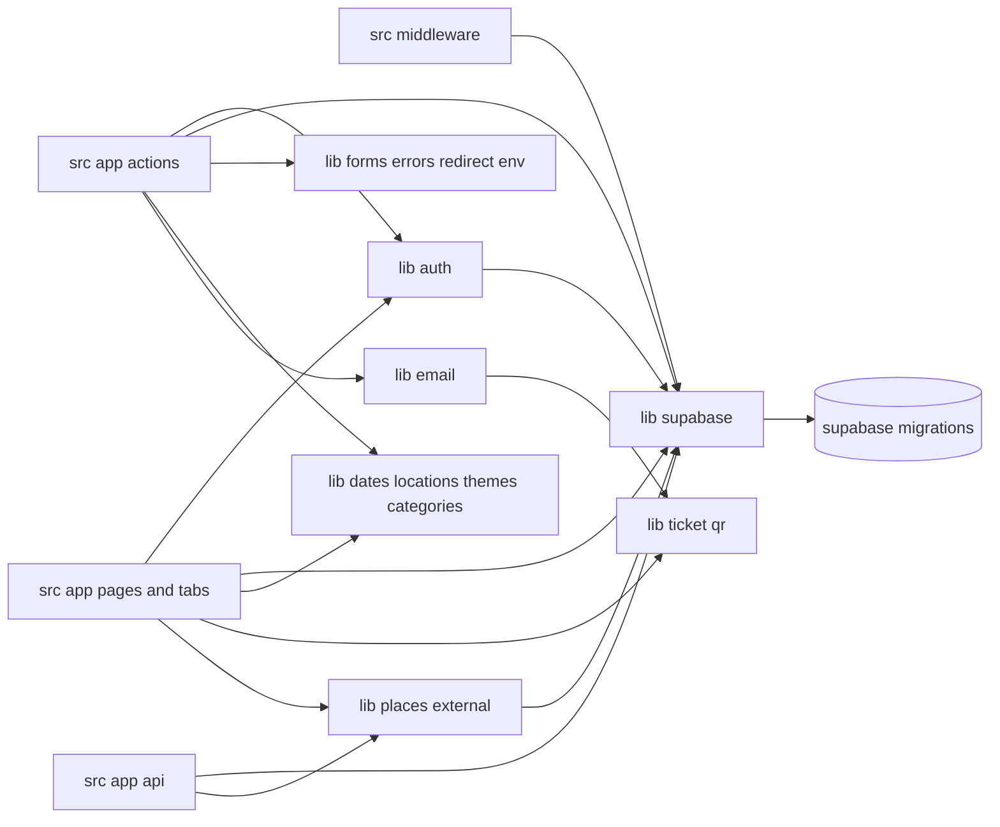

# Dependencies

## Internal Dependencies

Text alternative: pages, actions, routes and middleware all depend on `lib/supabase` directly, and through it on the schema in `supabase/migrations`. `lib/auth`, `lib/places` and `lib/ticket` also take a Supabase client as a parameter. There is no layer between the UI/actions and the data client.

### src/app depends on src/lib/supabase
- **Type**: Compile and runtime
- **Reason**: Every page and action builds its own client and queries tables or RPCs. 22 files call the Supabase client.

### src/lib/auth, places, ticket, event-page, getTheme depend on SupabaseServerClient
- **Type**: Compile
- **Reason**: Functions take the Supabase client type as a parameter, so the vendor type leaks into helper signatures.

### src/lib/supabase depends on supabase/migrations
- **Type**: Compile (generated types) and runtime (RLS, functions)
- **Reason**: `database.types.ts` is generated from the schema; CI fails if it is stale.

### supabase/migrations depends on Supabase platform schemas
- **Type**: Runtime
- **Reason**: `auth.users` foreign keys and trigger, `auth.uid()` in policies and functions, `storage.objects` policies and `storage.foldername`, the `anon` / `authenticated` roles.

## External Dependencies

### next
- **Version**: 15.5.27
- **Purpose**: Framework
- **License**: MIT

### react, react-dom
- **Version**: 19.1.0
- **Purpose**: UI
- **License**: MIT

### @supabase/supabase-js
- **Version**: ^2.117.3
- **Purpose**: Database, auth and storage client
- **License**: MIT

### @supabase/ssr
- **Version**: ^0.12.7
- **Purpose**: Cookie sessions for Next.js
- **License**: MIT

### Dev: typescript ^5 (Apache-2.0), eslint ^9 (MIT), eslint-config-next 15.5.27 (MIT), vitest ^3 (MIT), @types/* (MIT)

No other runtime packages. QR generation, email (Resend over `fetch`) and iCal parsing are written in-house.
